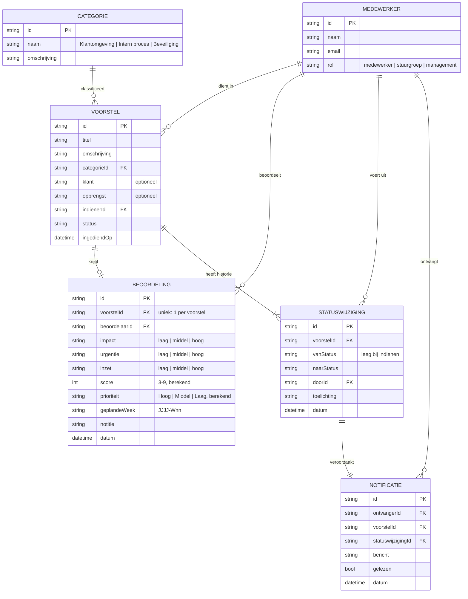
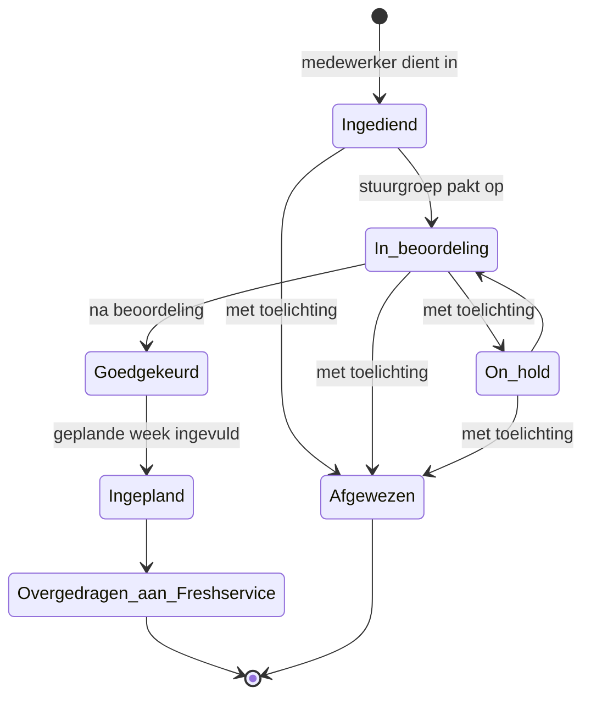

# Ontwerp – Verbeterregistratie (VBR)

> Bron voor scope en eisen: *Applicatie voorstel – Egency*, *Projectplan – VBR* en *Stakeholderanalyse Verbeterregistratie v0.1 (08-10-2026)*.
> Kaders uit de opdracht: maximaal 3 kernfunctionaliteiten en maximaal 6 entiteiten.

## 1. Probleem en doel (kort)

Medewerkers zien dagelijks verbeterkansen (klantomgevingen, interne processen, beveiliging), maar die worden nergens centraal vastgelegd en raken ondergesneeuwd. Doel: één plek om voorstellen in te dienen, een vast wekelijks beoordelingsproces door de stuurgroep, gegarandeerde terugkoppeling aan de indiener en overzicht voor management.

## 2. Requirements

### Functioneel (MoSCoW)

| ID | Requirement | Prioriteit | Bron | Aangetoond met |
|---|---|---|---|---|
| R1 | Een medewerker dient een voorstel in via een formulier van **maximaal 5 velden** (titel, omschrijving, categorie, klant, verwachte opbrengst). Titel, omschrijving en categorie zijn verplicht. | Must | Projectplan §4 | Test R1, TC-01/02 |
| R2 | Bij **elke statuswijziging** krijgt de indiener **automatisch** een bericht, met toelichting. Afwijzen of on hold zetten kan alleen mét toelichting. | Must | Projectplan §3/§4, risico "geen terugkoppeling" | Test R2, TC-04/05 |
| R3 | De stuurgroep beoordeelt op **impact, urgentie en inzet** (elk laag/middel/hoog). De app **berekent** de prioriteit. Goedgekeurde voorstellen worden ingepland in een week (capaciteit). | Must | Projectplan §3/§4 | Test R3, TC-03 |
| R4 | Management ziet op een **dashboard** het aantal voorstellen per status, categorie en prioriteit, de reactietijd en voorstellen die te lang wachten. | Must | Projectplan §4 | Test R4, TC-06 |
| R5 | Een indiener ziet in "Mijn voorstellen" de status en volledige historie van zijn/haar voorstellen. | Should | Voorstel: "collega's moeten zien dat er iets gebeurt" | TC-05 |
| R6 | Een goedgekeurd en ingepland voorstel kan worden gemarkeerd als "Overgedragen aan Freshservice". | Could | Afbakening: uitvoering via Freshservice | TC-04 |
| – | Koppeling met Freshservice, voorstellen van externen, overzetten van oude ideeën | Won't (nu) | Projectplan §5 | – |

### Niet-functioneel

| ID | Eis | Hoe getoetst |
|---|---|---|
| NF1 | Bruikbaarheid: een voorstel indienen kost minder dan 5 minuten. | Acceptatietest met testers (TC-07), tijd meten |
| NF2 | Veiligheid: ingevoerde tekst wordt nooit als code uitgevoerd (XSS). Alleen de stuurgroep kan beoordelen en status wijzigen. | TC-08, code review `esc()` |
| NF3 | Toegankelijkheid en apparaten: werkt op laptop en telefoon, bruikbaar met toetsenbord, labels bij alle velden. | TC-09 |
| NF4 | Onderhoudbaarheid: bedrijfsregels staan los van de schermen en zijn automatisch getest. | `npm test` (15 tests) |
| NF5 | Kosten en capaciteit: realiseerbaar binnen €2.500 en max. 2 uur per dag. | Projectplan, urenregistratie |

## 3. Datamodel (6 entiteiten)

### Toelichting op ontwerpkeuzes

- **Categorie als eigen entiteit** in plaats van vaste tekst: de stuurgroep kan later categorieën toevoegen zonder codewijziging, en het dashboard telt per categorie.
- **Beoordeling los van Voorstel** (0..1): niet elk voorstel wordt beoordeeld (bijv. direct afgewezen) en zo blijft duidelijk *wie* beoordeelde en *wanneer*.
- **Statuswijziging als historie**: de huidige status staat ook op Voorstel (snel filteren), maar de volledige historie maakt terugkoppeling en doorlooptijd meetbaar (dashboard: "gem. tijd tot eerste reactie").
- **Notificatie hoort bij één statuswijziging**: zo is aantoonbaar dat *elke* wijziging tot terugkoppeling leidt (R2, het grootste risico uit het projectplan).
- **Klant is een tekstveld, geen entiteit**: klantbeheer valt buiten scope en zou een 7e entiteit opleveren.
- **Prioriteit wordt berekend, niet ingevuld**: `score = impact + urgentie + (4 − inzet)` met laag=1, middel=2, hoog=3. Score 7–9 = Hoog, 5–6 = Middel, 3–4 = Laag. Zo is de prioriteit uitlegbaar en consistent tussen stuurgroepleden.

## 4. Statusmodel (procesflow)

Elke pijl maakt een Statuswijziging en een Notificatie voor de indiener aan.

## 5. Rollen en rechten

| Functie | Medewerker | Stuurgroep | Management |
|---|---|---|---|
| Voorstel indienen | ✓ | ✓ | ✓ |
| Eigen voorstellen en berichten | ✓ | ✓ | ✓ |
| Beoordelen en status wijzigen | – | ✓ | – |
| Dashboard | – | ✓ | ✓ |

## 6. Product backlog en sprintindeling

Indeling volgt het projectplan: 3 sprints van 2 weken, max. 2 uur per dag.

| Sprint | User story | Acceptatiecriteria | Req. |
|---|---|---|---|
| 1 | Als **medewerker** wil ik een voorstel snel kunnen indienen, zodat mijn idee niet verloren gaat. | Max. 5 velden; verplichte velden gecontroleerd; bevestiging na indienen; binnen 5 min in te vullen. | R1, NF1 |
| 1 | Als **medewerker** wil ik mijn voorstellen en hun status zien, zodat ik weet wat ermee gebeurt. | Lijst met eigen voorstellen, status en laatste update; historie per voorstel. | R5 |
| 2 | Als **stuurgroeplid** wil ik een voorstel scoren op impact, urgentie en inzet, zodat we objectief prioriteren. | Drie keuzes L/M/H; prioriteit wordt direct berekend en getoond; 1 beoordeling per voorstel. | R3 |
| 2 | Als **stuurgroeplid** wil ik de status wijzigen en goedgekeurde voorstellen inplannen, zodat de capaciteit bewaakt wordt. | Alleen toegestane overgangen; goedkeuren pas na beoordeling; inplannen pas met week. | R2, R3 |
| 2 | Als **indiener** wil ik automatisch bericht krijgen bij elke statuswijziging, zodat ik zie dat er iets met mijn idee gebeurt. | Elke wijziging → bericht; bij afwijzen/on hold verplichte toelichting; teller ongelezen berichten. | R2 |
| 3 | Als **manager** wil ik een dashboard, zodat ik in één oogopslag zie wat er openstaat. | Aantallen per status/categorie/prioriteit; gem. reactietijd; signaal bij > 7 dagen zonder reactie. | R4 |
| 3 | Als **stuurgroeplid** wil ik een overdracht naar Freshservice kunnen markeren. | Status "Overgedragen aan Freshservice" alleen vanuit Ingepland. | R6 |

## 7. Definition of Done

Een user story is af als:

1. De acceptatiecriteria aantoonbaar werken in het prototype.
2. De bijbehorende geautomatiseerde tests slagen (`npm test`) en de GitHub Actions-run groen is.
3. De wijziging is gecommit in GitHub met een duidelijke beschrijving.
4. Ingevoerde tekst wordt veilig getoond (geen XSS) en het scherm werkt op laptop en telefoon.
5. Een tester (Matthijs of AnneMirthe) heeft de story in de Sprint Review gezien en goedgekeurd.
6. De iteratielog is bijgewerkt (wat geleerd, wat aangepast).

## 8. Open punten voor de stuurgroep

- **Beveiligingsvoorstellen:** krijgen die een eigen, hogere prioriteitsregel of een directe melding aan de security officer? (Stakeholderanalyse, Arjen Fiechter.) Nu niet gebouwd. Het dashboard toont wel het aantal per categorie.
- **Platform voor de MVP:** het projectplan noemt dit nog niet. Zie de roadmap in het Plan van Aanpak (bijv. Power Apps + SharePoint + Power Automate binnen Microsoft 365, of deze webapp met een gedeelde database).
- **Vervanger voor de Product Owner** bij afwezigheid van Olaf (risico uit stakeholderanalyse).
